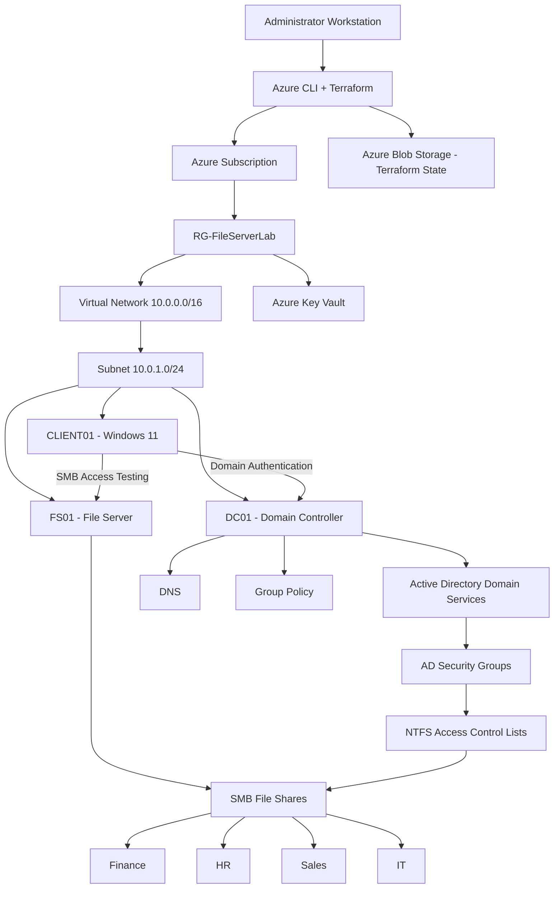

# NTFS File Server Lab

**Active Directory | NTFS Permissions | SMB File Services | Group Policy | Terraform | PowerShell**

> **Project Status:** Implementation guide — deployment and verification pending.

## Project Overview

This project demonstrates the deployment and configuration of an enterprise-style Windows file server environment using Microsoft Azure, Active Directory Domain Services (AD DS), NTFS permissions, SMB file sharing, Group Policy, Terraform, and PowerShell.

The lab implements departmental access controls for Finance, Human Resources, Sales, and IT using Active Directory security groups.

The infrastructure is provisioned with Terraform, while PowerShell scripts automate domain configuration, user provisioning, file sharing, permissions, and validation.

### Lab Environment

| Component | Configuration |
|-----------|---------------|
| Domain | `lab.local` |
| Azure Region | Central US |
| Domain Controller | DC01 — Windows Server 2022 |
| File Server | FS01 — Windows Server 2022 |
| Workstation | CLIENT01 — Windows 11 |
| Resource Group | RG-FileServerLab |
| Virtual Network | 10.0.0.0/16 |
| Subnet | 10.0.1.0/24 |
| Domain Controller IP | 10.0.1.4 |
| Infrastructure Automation | Terraform |
| Configuration Automation | PowerShell |
| Secret Management | Azure Key Vault |
| Estimated Deployment | 10–15 minutes for Terraform, plus 15–20 minutes for configuration (not verified) |

> **Cost:** Azure charges depend on the selected VM sizes, disks, public IPs, and region. Check current pricing before deployment.

---

## Table of Contents

1. [Project Overview](#project-overview)
2. [Business Scenario](#business-scenario)
3. [Architecture Diagram](#architecture-diagram)
4. [Technology Stack](#technology-stack)
5. [Learning Objectives](#learning-objectives)
6. [Prerequisites](#prerequisites)
7. [Step 1 — Create Project Folder](#step-1--create-project-folder)
8. [Step 2 — Create Terraform Files](#step-2--create-terraform-files)
9. [Step 3 — Configure Remote State](#step-3--configure-remote-state)
10. [Step 4 — Configure Variables](#step-4--configure-variables)
11. [Step 5 — Deploy Infrastructure](#step-5--deploy-infrastructure)
12. [Step 6 — Create PowerShell Scripts](#step-6--create-powershell-scripts)
13. [Step 7 — Create Orchestration Script](#step-7--create-orchestration-script)
14. [Step 8 — Run Lab Configuration](#step-8--run-lab-configuration)
15. [Step 9 — Verify Lab](#step-9--verify-lab)
16. [Step 10 — Pause or Tear Down](#step-10--pause-or-tear-down)
17. [Troubleshooting](#troubleshooting)

---

## Business Scenario

Organizations must protect sensitive departmental information while allowing authorized employees to access the resources required for their roles.

For example:

- Finance employees require read/write access to financial documents.
- Human Resources employees require read/write access to HR documents.
- HR employees also require read-only access to Finance documents for reporting.
- IT administrators require full control over departmental resources.
- Sales employees must not access Finance or HR data.

This lab uses Active Directory security groups and NTFS access control lists to enforce these requirements.

### Departmental Access Matrix

| Department | Finance | HR | Sales | IT |
|------------|---------|----|-------|----|
| Finance | Modify | Denied | Denied | Denied |
| HR | Read | Modify | Denied | Denied |
| Sales | Denied | Denied | Modify | Denied |
| IT | Full Control | Full Control | Full Control | Full Control |

### Test Users

| Username | Department | AD Security Group |
|----------|------------|-------------------|
| john.smith | IT | GRP_IT |
| sarah.jones | Finance | GRP_Finance |
| mike.brown | Finance | GRP_Finance |
| lisa.white | HR | GRP_HR |
| tom.davis | Sales | GRP_Sales |

These users will be used to validate the NTFS permission model.

---

## Architecture Diagram



### Architecture Components

| Component | Purpose |
|-----------|---------|
| Azure Resource Group | Organizes lab infrastructure |
| Virtual Network | Provides private network connectivity |
| Subnet | Hosts the three virtual machines |
| Network Security Group | Restricts inbound network traffic |
| DC01 | Hosts AD DS, DNS, and Group Policy |
| FS01 | Hosts SMB shares and NTFS permissions |
| CLIENT01 | Tests domain authentication and file access |
| Azure Key Vault | Stores administrative credentials |
| Terraform | Provisions Azure infrastructure |
| PowerShell | Automates Windows configuration |
| Azure Blob Storage | Stores Terraform remote state |

### Network Configuration

| Resource | IP Address |
|----------|------------|
| VNet | 10.0.0.0/16 |
| Subnet | 10.0.1.0/24 |
| DC01 | 10.0.1.4 |
| FS01 | Dynamic private IP |
| CLIENT01 | Dynamic private IP |

DC01 uses a static private IP because FS01 and CLIENT01 must use it for DNS resolution.

---

## Technology Stack

| Technology | Function |
|------------|----------|
| Microsoft Azure | Cloud infrastructure |
| Windows Server 2022 | Domain controller and file server |
| Windows 11 | Client workstation |
| Active Directory Domain Services | Centralized identity management |
| Active Directory Security Groups | Role-based file access |
| NTFS | File system access permissions |
| SMB | Network file sharing |
| Group Policy | Centralized Windows configuration |
| Terraform | Infrastructure as Code |
| PowerShell | Automation and administration |
| Azure Key Vault | Secret storage |
| Azure CLI | Azure resource management |
| GitHub | Project documentation and version control |

---

## Learning Objectives

By completing this lab, the intended outcomes are:

1. Provision Azure virtual machines using Terraform.
2. Deploy Active Directory Domain Services.
3. Promote Windows Server to a domain controller.
4. Configure Active Directory DNS.
5. Create organizational units.
6. Create Active Directory security groups.
7. Provision departmental user accounts.
8. Join Windows computers to a domain.
9. Configure SMB file shares.
10. Implement NTFS access controls.
11. Apply group-based permissions.
12. Configure Group Policy.
13. Manage credentials using Azure Key Vault.
14. Automate administrative tasks with PowerShell.
15. Validate authorized and unauthorized access.
16. Troubleshoot Active Directory and file-sharing issues.
17. Manage infrastructure lifecycle using Terraform.

---

## Prerequisites

Before beginning, verify the following requirements.

### Required Software

- Terraform 1.5 or later
- Azure CLI
- Windows PowerShell 5.1 or later
- Visual Studio Code
- Azure subscription
- Appropriate Azure permissions

### Verify Terraform

```powershell
terraform -version
```

### Verify Azure CLI

```powershell
az version
```

### Verify PowerShell

```powershell
$PSVersionTable.PSVersion
```

### Authenticate to Azure

```powershell
az login
```

### Verify Subscription

```powershell
az account show
```

### Select Subscription

```powershell
az account set --subscription "<SUBSCRIPTION_ID>"
```

### Screenshot Evidence

Capture the following evidence during implementation:

- `NTFS-01` — Terraform version
- `NTFS-02` — Azure CLI version
- `NTFS-03` — Azure subscription verification

> **Security note:** Do not include subscription identifiers, access tokens, passwords, or other sensitive information in public screenshots.

---

## Step 1 — Create Project Folder

Create a dedicated folder for the lab.

### Create Root Directory

```powershell
New-Item -ItemType Directory -Path "$HOME\ntfs-lab-terraform" -Force
```

### Navigate to Directory

```powershell
Set-Location "$HOME\ntfs-lab-terraform"
```

### Create Scripts Directory

```powershell
New-Item -ItemType Directory -Path ".\scripts" -Force
```

### Project Structure

```text
ntfs-lab-terraform/
│
├── backend.tf
├── versions.tf
├── variables.tf
├── main.tf
├── keyvault.tf
├── outputs.tf
├── terraform.tfvars.example
├── terraform.tfvars
├── .gitignore
├── configure-lab.ps1
│
└── scripts/
    ├── 00-promote-dc.ps1
    ├── 01-create-ad-users-groups.ps1
    ├── 02-configure-shares-and-permissions.ps1
    ├── 03-configure-rdp-gpo.ps1
    ├── 04-domain-join.ps1
    ├── 05-verify-ad.ps1
    ├── 05-verify-shares.ps1
    └── 06-add-rdp-users.ps1
```

### Screenshot Evidence

- `NTFS-04` — VS Code project folder
- `NTFS-05` — Terraform and scripts directory structure

---

## Step 2 — Create Terraform Files

The following files define the Azure infrastructure.

### File: backend.tf

This file configures remote Terraform state storage.

> Complete Step 3 to create the storage account before running `terraform init`.

```hcl
terraform {
  backend "azurerm" {
    resource_group_name  = "RG-TerraformState"
    storage_account_name = "REPLACE_WITH_YOUR_STORAGE_ACCOUNT_NAME"
    container_name       = "tfstate"
    key                  = "ntfs-lab.terraform.tfstate"
  }
}
```

Lab 2 will use a separate state key:

```text
rbac-lab.terraform.tfstate
```

This prevents the two Terraform projects from overwriting each other's state.

### File: versions.tf

```hcl
terraform {
  required_version = ">= 1.5.0"

  required_providers {
    azurerm = {
      source  = "hashicorp/azurerm"
      version = "~> 3.0"
    }

    random = {
      source  = "hashicorp/random"
      version = "~> 3.6"
    }

    time = {
      source  = "hashicorp/time"
      version = "~> 0.11"
    }
  }
}

provider "azurerm" {
  features {}
}
```

### File: variables.tf

```hcl
variable "location" {
  type    = string
  default = "Central US"
}

variable "resource_group_name" {
  type    = string
  default = "RG-FileServerLab"
}

variable "vnet_name" {
  type    = string
  default = "VNET-FileServerLab"
}

variable "subnet_name" {
  type    = string
  default = "Subnet-Servers"
}

variable "vnet_cidr" {
  type    = string
  default = "10.0.0.0/16"
}

variable "subnet_cidr" {
  type    = string
  default = "10.0.1.0/24"
}

variable "nsg_name" {
  type    = string
  default = "NSG-RDP"
}

variable "rdp_source" {
  type        = string
  default     = "*"
  description = "Your public IP in CIDR format, e.g. 1.2.3.4/32."
}

variable "admin_username" {
  type    = string
  default = "azureadmin"
}

variable "admin_password" {
  type        = string
  sensitive   = true
  description = "Set using TF_VAR_admin_password."
}

variable "server_vm_size" {
  type    = string
  default = "Standard_B2as_v2"
}

variable "client_vm_size" {
  type    = string
  default = "Standard_B2as_v2"
}
```

> **Security:** Set `rdp_source` to your public IP address with `/32` before deployment. Do not use the unrestricted default `*`.

> Terraform sensitive variables suppress normal CLI display but do not prevent secret values from being stored in Terraform state. Secure the state storage and use disposable lab credentials.

### Screenshot Evidence

- `NTFS-06` — backend.tf configuration
- `NTFS-07` — versions.tf configuration
- `NTFS-08` — variables.tf configuration

---

<!-- Continue with main.tf, keyvault.tf, outputs.tf,
     remaining Terraform files, Steps 3–10,
     all PowerShell scripts, validation and troubleshooting. -->
